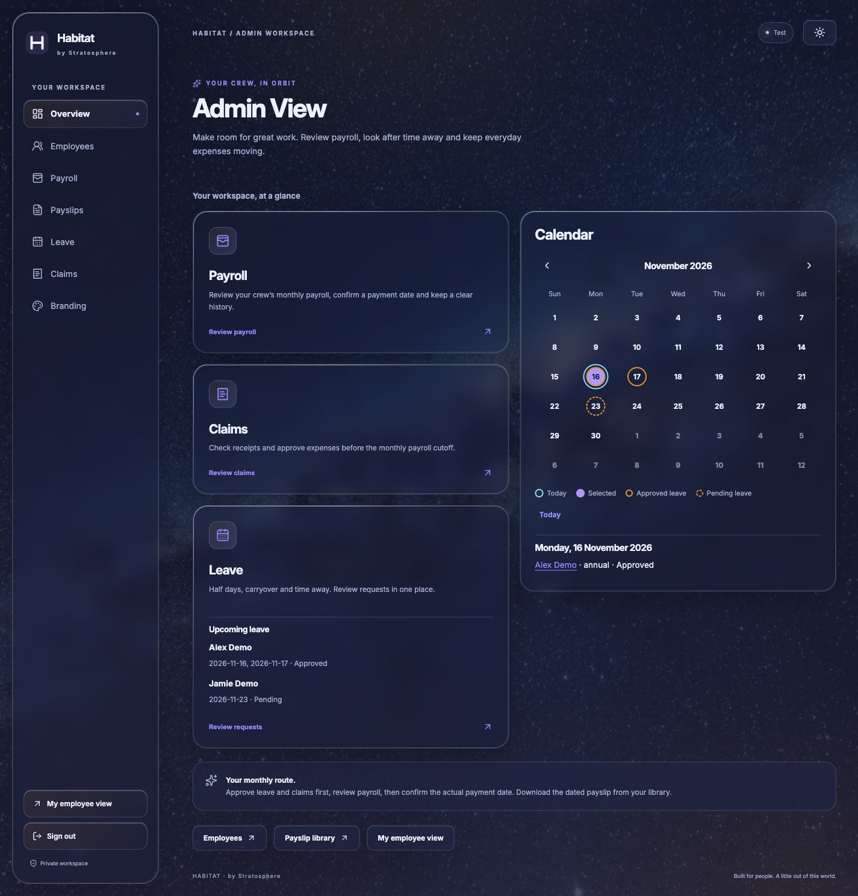

# Habitat

**v0.1.0-alpha.1 · Developer preview** · [Changelog](CHANGELOG.md) · [Quick start](docs/QUICKSTART.md) · [Security](SECURITY.md)

Habitat is built primarily for Singapore SMEs with fewer than 10 employees. It keeps payroll, leave and claims straightforward because small teams often need a practical tool without complicated systems and policies. It was built for that everyday need and is shared to help other SME owners.

Habitat is designed around relevant Singapore employment requirements and guidance from the Ministry of Manpower (MOM) and CPF Board, within the supported scope described below. It is not government-endorsed or a compliance certification. Employers must configure their policies and check current obligations and entitlements, regardless of team size. Claims policies are company-specific, not a universal government standard.

This is an early developer preview for technical evaluation and fictional-data testing. Installation and upgrade contracts are still evolving; it is not a turnkey payroll service. Start with the [fictional demo guide](docs/QUICKSTART.md).

## Admin dashboard



Dark-mode example using fictional company, employees and records. No real employee or financial data is shown.

## Features

- Administrator employee add, edit and archive with retained history; employee own-profile access and address/postal editing.
- Annual leave and carryover balances, audited adjustments, half-day/backdated requests, and optional private medical attachments.
- Claims with private image receipts and authenticated browser previews.
- Saved employee/company payroll settings, monthly employee selection and additional wages, automatic eligible approved-claim capture, and recoverable unissued drafts.
- Run-level payment-date recording with automatic private payslip generation, safe retries, and immutable void/replacement history. Employees download only their current documents.
- Light/dark themes, responsive layouts, company branding and an overview leave calendar.

Payroll supports a bounded single-company Singapore-citizen workflow. Residency, eligibility, unusual pay cases and annual opening information require appropriate setup; unknown information is not silently zero. Effective-dated rules are configured in code. Future periods use the latest configured rules with a notice; that does not establish that future statutory rules have been verified. Review the configured rules before using them.

Recording a payment is bookkeeping. The application does not perform bank/CPF transfers. Live email and automatic employee invitations are not enabled by this source distribution.

## Singapore guidance

Use the current official guidance when configuring and reviewing an installation:

- [MOM employment records](https://www.mom.gov.sg/employment-practices/employment-records)
- [MOM itemised payslips](https://www.mom.gov.sg/employment-practices/salary/itemised-payslips)
- [MOM annual leave eligibility and entitlement](https://www.mom.gov.sg/employment-practices/leave/annual-leave/eligibility-and-entitlement)
- [CPF Board contribution guidance](https://www.cpf.gov.sg/employer/employer-obligations/how-much-cpf-contributions-to-pay)

A simple interface does not reduce an employee's applicable legal entitlements. Unsupported employment/pay cases require an appropriate separate process rather than an assumption that the application covers them.

## Development

Use Node.js 24.x and the exact dependencies in `package-lock.json`. Integration tests use disposable PostgreSQL 17 databases. Real image/PDF processing additionally requires the pinned isolated Docker processors; the supplied reference profile targets Linux ARM64 containers and a macOS Docker Desktop host.

```sh
npm ci
npm run typecheck
npm test
npm run build
```

The standard suite includes fictional fixtures and skips an opt-in real-PDF case. Passing it does not prove an installation's browser journeys, statutory acceptance, file processing or disaster recovery.

After building, `npm run demo` starts a temporary loopback-only fictional demo. Follow the [quick-start guide](docs/QUICKSTART.md) to locate its URL and credentials. Keep its generated credentials local and stop it with Ctrl-C. For a manually prepared local database, `.env.example` documents placeholder settings; provide fresh environment-specific secrets. There is no universal migrate-and-bootstrap command for an existing database. Do not run fresh-target provisioners against populated systems.

## Hosting and operation

Keep development, fictional verification and real business data in separate databases, file stores and authentication configurations. The deployment scripts are a constrained reference implementation, not authorization to expose an installation publicly or widen access. Production profiles fail closed unless their explicit capability and identity checks pass.

See [operating guidance](SME-GUIDE.md), [private document processing](ops/documents/README.md), [PDF processing](ops/payslip-pdf/README.md), and [statutory fixture sources](docs/statutory-fixture-sources.json). Before live use, verify role/ownership boundaries, supported payroll cases, reconciliation, populated backup restore, key custody and device/browser acceptance. Personal identifiers, bank data, uploads, generated PDFs, secrets and real databases belong outside source control.

## Customisation

See [Adapt Habitat to your company](CUSTOMISATION.md) for an optional Claude Code or OpenAI Codex workflow using fictional data, reviewed changes and the existing checks.

## Current status and releases

The initial public source was exported without private development history or company-private extensions. Its examples are fictional; it contains no employee accounts or company logo assets. Habitat's original code is available under the [MIT License](LICENSE), copyright (c) 2026 Stratosphere Creative Works Pte. Ltd. Third-party assets and dependencies retain their own licenses, as described in [Third-party notices](THIRD_PARTY_NOTICES.md). MIT's standard warranty/liability disclaimer is not a promise of immunity from all claims. A public release identifies a source snapshot; it does not establish acceptance of a particular payroll installation. See [release and upgrade guidance](docs/RELEASING.md).


### Known limitations

- Node.js 24 and a technical operator are required. The reference document processors target Linux ARM64; other production platforms have not been accepted.
- No general production installer or automatic migration/upgrade command is provided. The local demo is disposable, not persistent company hosting.
- Live email, bank/CPF transfers and automatic invitations are not enabled. Unsupported employment/pay scenarios need a separately verified process.
- Standard tests use fictional data and skip optional real-renderer checks. Browser acceptance, populated recovery and current statutory configuration require separate validation.
- The locked dependency install currently reports four moderate advisories in a development-tool dependency chain. See [security status](SECURITY.md); no dependency updates were bundled into this preview.

GitHub Actions checks the source on pushes and pull requests. Real image/PDF isolation and browser/device testing are separate checks; a green workflow is not a payroll compliance certification.
